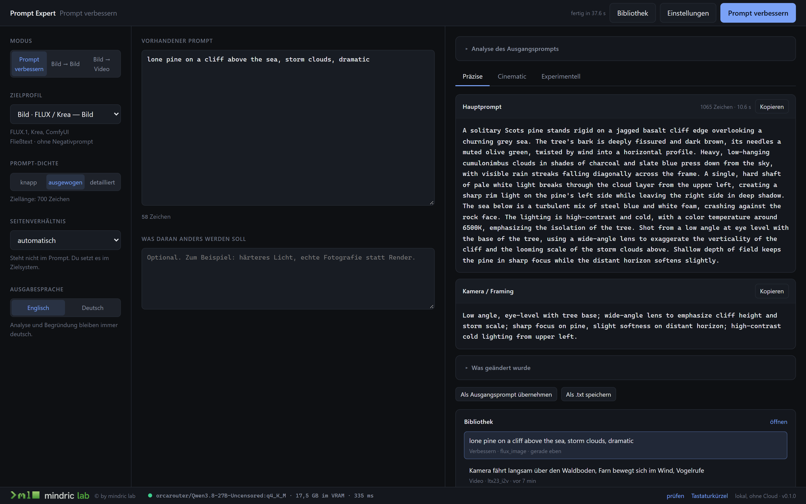
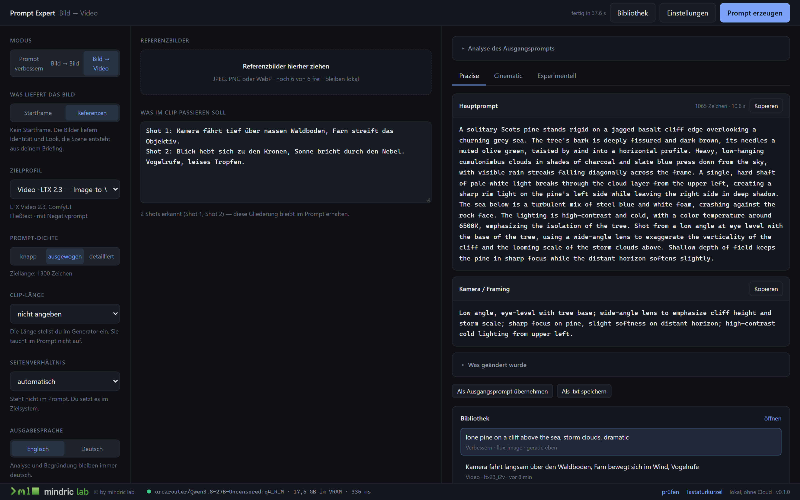
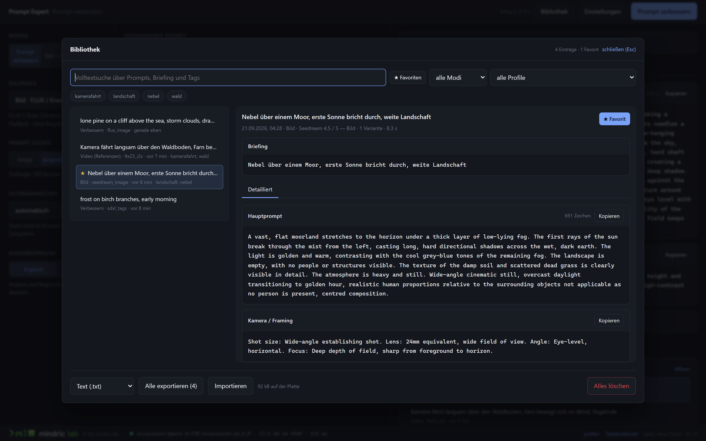
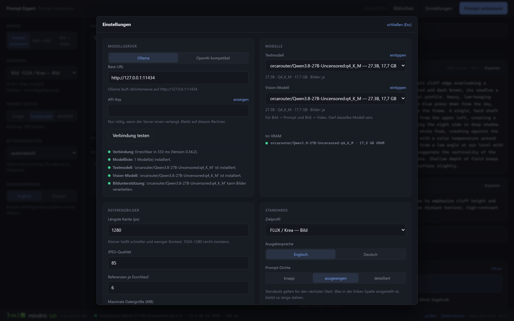

# Prompt Expert

Lokale Prompt-Werkstatt für Bild- und Video-Generatoren. Erzeugt und verbessert Prompts für
WAN 2.2, LTX 2.3, FLUX/Krea, SDXL, Seedream, MiniMax und GPT-Image — komplett auf dem
eigenen Rechner, ohne Account, ohne Cloud, ohne Telemetrie.

Die App generiert selbst keine Bilder und keine Videos. Sie liefert Prompts zum Kopieren.



## Wofür das gut ist

Jeder Generator will seinen Prompt anders: FLUX mag ganze Sätze, SDXL will Danbooru-Tags,
LTX 2.3 erwartet Zeitmarken wie `[0-4 sec]`, MiniMax nimmt wenige klare Bewegungen. Denselben
Text überall hineinzukippen ist der häufigste Grund für Ausreißer.

Prompt Expert kennt diese Unterschiede als **Zielprofile** — eine JSON-Datei je Generator,
kein Code. Aus einem Briefing oder einem Referenzbild entsteht ein Prompt, der im gewählten
Zielsystem sofort benutzbar ist, in drei Fassungen zur Auswahl.

## Was es nicht ist

- **Kein Bildgenerator.** Keine Anbindung an ComfyUI, Wavespeed oder sonst etwas.
- **Kein Cloud-Dienst.** Der einzige ausgehende Netzverkehr geht an den lokalen
  Modellserver, dessen Adresse in den Einstellungen steht.
- **Kein Mehrbenutzersystem.** Ein Rechner, ein Nutzer, eine SQLite-Datei.

## Voraussetzungen

- Windows 11, Python 3.12, Node 20+
- [Ollama](https://ollama.com) oder ein anderer OpenAI-kompatibler Server
  (LM Studio, llama.cpp, KoboldCpp, vLLM)
- Eine GPU mit genug VRAM für das gewählte Modell. Gemessen auf einer RTX 4090:
  16,3 GB für das Standardmodell, warm rund 4 s je Variante.

## Schnellstart

```powershell
ollama pull orcarouter/Qwen3.8-27B-Uncensored:q4_K_M
powershell -ExecutionPolicy Bypass -File scripts\build_frontend.ps1
.\start.bat
```

`start.bat` legt beim ersten Start die virtuelle Umgebung an, installiert die
Abhängigkeiten und öffnet den Browser, sobald der Server antwortet. Danach läuft alles
unter http://127.0.0.1:8756 — ein Port, ein Befehl. Die API-Doku liegt unter `/docs`.

Ein anderes Modell? Läuft, solange es Vision **und** Text kann. Die Auswahl steht in den
Einstellungen; Vollständige Installation inklusive Alternativen und gemessener Werte:
[`docs/SETUP.md`](docs/SETUP.md).

## Die drei Modi

- **Prompt verbessern** — analysiert einen vorhandenen Prompt, benennt die Schwächen und
  erzeugt drei gezielte Fassungen.
- **Bild → Prompt** — bis zu sechs Referenzen mit Rollen (Subjekt, Stil, Komposition,
  Kleidung, Umgebung). *Nachbauen* beschreibt das vorhandene Bild so genau wie möglich,
  *Als Vorlage* nimmt Look und Merkmale für eine neue Szene. Ohne Bild wird daraus ein
  reiner Text-zu-Bildprompt.
- **Bild → Video** — *Startframe*: das Modell hat den ersten Frame bereits, der Prompt
  beschreibt deshalb ausschließlich die Handlung. *Referenzen*: die Bilder liefern
  Identität, die Szene wird gebaut. Ergebnis ist **ein** Block zum Kopieren, weil der
  Generator dort nur ein Eingabefeld hat.

Je drei Varianten (Präzise / Cinematic / Experimentell), ein Dichte-Regler, Ausgabesprache
Deutsch oder Englisch.



Gliederst du das Briefing selbst in *Shot 1, Shot 2, …*, bleibt diese Struktur im Prompt
erhalten. Widersprüche in Bewegung, Kamera und Zeitachse werden gemeldet, nicht still
korrigiert.

## Bibliothek

Jeder fertige Lauf wird automatisch gespeichert — ein Eintrag je Lauf, mit Briefing,
Referenz-Vorschaubildern und allen Varianten zusammen. Volltextsuche, Tags, Favoriten,
Import und Export als `.txt` / `.json` / `.csv`, Einzel- und Komplettlöschung. In den
Einstellungen abschaltbar.



## Modellauswahl



Die Einstellungen zeigen, was auf dem Server tatsächlich installiert ist, mit Größe,
Quantisierung und der Angabe, ob ein Modell Bilder verarbeiten kann. Was der Server nicht
meldet, heißt *unbekannt* und wird nicht geraten. Ein eingetragenes, aber fehlendes Modell
verschwindet nicht aus der Liste — es steht dort mit dem passenden `ollama pull`-Befehl.

## Tastaturkürzel

| Taste | Wirkung |
|---|---|
| `Strg` + `Enter` | Lauf starten, auch aus dem Textfeld heraus |
| `Esc` | Laufenden Lauf abbrechen, oder ein offenes Fenster schließen |
| `Strg` + `K` | Bibliothek öffnen, Cursor steht in der Suche |
| `Strg` + `,` | Einstellungen öffnen |
| `1` `2` `3` | Zwischen den Varianten wechseln |
| `Alt` + `C` | Hauptprompt der offenen Variante kopieren |

## Zielprofile

FLUX/Krea · SDXL/Pony/Illustrious · Seedream 4.5/5 · GPT-Image 2.5 · WAN 2.2 · LTX 2.3 ·
MiniMax · Identity-Edit.

Ein neues Ziel ist eine JSON-Datei in `backend/app/profiles/`, kein Codeeingriff. Ein Profil
steuert Grammatik, Sprache, Längenziel, Negativprompt-Format, bevorzugte Begriffe, verbotene
Füllphrasen und die Explizitheits-Stufe. Schema und Beispiele:
[`docs/PROFILE.md`](docs/PROFILE.md).

## Inhalte

Die App ist für erwachsene, fiktionale Inhalte gebaut und weicht Formulierungen nicht auf.
Zwei Grenzen greifen als ein Gate vor jeder Analyse: Figuren müssen eindeutig erwachsen
wirken, sonst bricht die Analyse mit konkretem Hinweis ab; und es werden nie Namen realer
Personen in Prompts übernommen — beschrieben wird, was sichtbar ist. Begründung und Details
stehen in [`CLAUDE.md`](CLAUDE.md).

## Architektur in drei Sätzen

Zwei getrennte Modellaufgaben statt eines großen Aufrufs: Die **Analyse** beschreibt Bilder
und Briefing zu einem streng validierten `SceneSpec`. Die **Komposition** macht daraus je
Variante einen Prompt und sieht das Rohbild nie — deshalb kostet eine weitere Variante keine
zweite Bildanalyse. Dazwischen liegt genau ein Provider-Adapter für alle unterstützten
Server. Mehr: [`docs/ARCHITEKTUR.md`](docs/ARCHITEKTUR.md).

## Entwicklung

```powershell
.\start.bat
powershell -ExecutionPolicy Bypass -File scripts\frontend.ps1   # Vite auf 5173, Hot Reload
cd backend; .\.venv\Scripts\python -m pytest -q                 # 262 Tests, ohne Ollama
```

Die Tests laufen ohne laufenden Modellserver — alle Providerzugriffe sind gemockt, bis auf
einen, der zur Prüfung einen echten HTTP-Stub startet.

| Datei | Inhalt |
|---|---|
| [`CLAUDE.md`](CLAUDE.md) | Leitdatei, Produktgrenzen, Stack |
| [`docs/SETUP.md`](docs/SETUP.md) | Installation, Modelle, VRAM |
| [`docs/ARCHITEKTUR.md`](docs/ARCHITEKTUR.md) | Pipeline, Provider, Verträge, Fehlerformat |
| [`docs/PROMPT_PIPELINE.md`](docs/PROMPT_PIPELINE.md) | Systemprompts, Varianten, Dichte |
| [`docs/PROFILE.md`](docs/PROFILE.md) | Zielprofil-Schema und mitgelieferte Profile |
| [`docs/UX.md`](docs/UX.md) | Oberfläche, Status, Fehlertexte |
| [`docs/ROADMAP.md`](docs/ROADMAP.md) | Meilensteine und was dabei entschieden wurde |

## Wo die Daten liegen

`%APPDATA%\PromptExpert\` — `settings.json`, `library.db`, Vorschaubilder und die Uploads
der laufenden Sitzung. Diesen Ordner zu löschen setzt die App vollständig zurück.

## Lizenz

Apache License 2.0, siehe [`LICENSE`](LICENSE).

Die Lizenz gilt für den Code. Name und Wortlogo von *mindric lab* sind davon
ausgenommen — Einzelheiten in [`NOTICE`](NOTICE). Wer forkt, ersetzt diese Kennzeichen bitte
durch eigene; die App läuft ohne sie unverändert.

---

© by mindric lab
